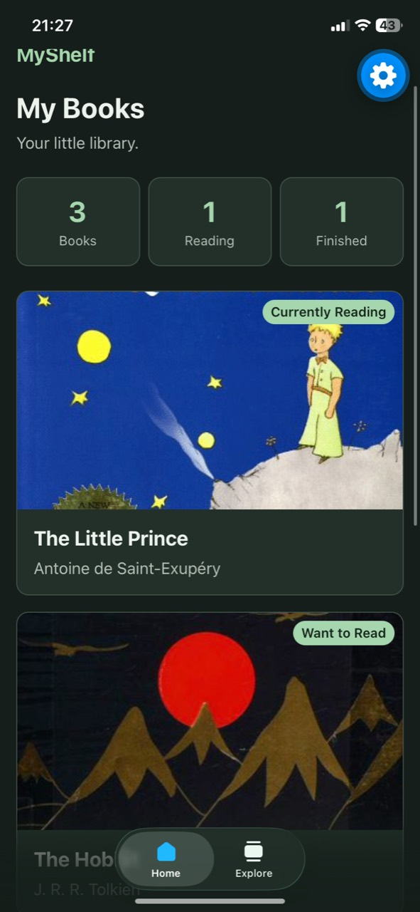

# MyShelf

MyShelf is a personal book library built with React Native, Expo SDK 58 and TypeScript.

Users can view books, reading statuses and book details. The current version uses mock data.

## Run

```sh
npm install
npm start
```

Open the QR code in a compatible Expo Go version.

To open the app in a browser, press `w` in the Expo terminal.

If PowerShell blocks npm, use:

```sh
npm.cmd start
```

## Week 4 — First Screens

- Five sample books with a shared TypeScript type.
- Reusable book cards with images, titles and authors.
- Press feedback and book ID logging.
- Reusable details component that receives a book through props.
- Book data inspected in React Native DevTools.

## Week 5 — Theme and Layout

- Shared light and dark colours.
- Automatic theme selection based on the device setting.
- Shared spacing, font sizes and corner radii.
- Theme colours applied to screens, cards and navigation.
- Status bar icons adapt to light and dark mode.
- Book cards with 16:9 images and reading-status badges.
- Summary statistics calculated from book data.
- One column below 600, two from 600 and three from 900.
- Book details centred with a maximum width of 600.
- Safe area support and scrollable content.

## Week 6 — Main List Screen

- FlatList with a scrolling header and summary statistics.
- Responsive columns using numColumns.
- Empty, loading and error states.
- Retry button after a loading error.
- Pull-to-refresh while existing books remain visible.
- Reading-status filters with specific empty messages.
- Long-press deletion with Cancel and Delete confirmation.
- Default, title A–Z and title Z–A sorting.
- Sorting uses a copy and preserves the original order.
- Temporarily tested scrolling with 200 items on a phone.

Normal operation uses five sample books.

Deletion only changes local component state. Pull-to-refresh or reloading restores the sample books.

The Add Book control is a static preview. Adding, editing and saving books will be implemented in later milestones.

Explore currently displays the first sample book. Opening a selected book from the list is planned for a later milestone.

## Project Structure

- `src/app/index.tsx` — book list, statistics, filters, sorting and deletion.
- `src/app/explore.tsx` — displays the first sample book's details.
- `src/types.ts` — shared Book type.
- `src/components/BookCard.tsx` — reusable interactive book card.
- `src/components/BookDetails.tsx` — reusable book details.
- `src/components/EmptyState.tsx` — empty-list messages.
- `src/components/FilterChip.tsx` — filter and sort buttons.
- `src/components/shelf-screen.tsx` — scrollable details screen container.
- `src/constants/theme.ts` — colours and design scales.
- `src/hooks/use-theme.ts` — selects light or dark colours.
- `src/data/books.ts` — five sample books.
- `src/data/api.ts` — simulated loading of book data.
- `docs/` — screenshots.

## Screenshots

### Light mode


### Dark mode



## Manual Checks

- Switch between light and dark mode while the app is running.
- Increase the phone's text size and check wrapping and scrolling.
- Resize the browser to check one, two and three columns.
- Check that book details stay centred on wide screens.
- Scroll to the bottom and check that the last item is fully visible.
- Check each reading-status filter and its selected colour.
- Check the empty message when a filter has no matching books.
- Check loading, simulated errors and the retry button.
- Pull down on the phone to refresh the list.
- Long-press a book and check both Cancel and Delete.
- Check that deletion updates the summary statistics.
- Refresh and check that deleted sample books return.
- Switch between both title sort orders and Default.

The app keeps portrait orientation on the phone. Different widths are tested in the browser.

Native deletion dialogs and pull-to-refresh are tested on the phone.

## Code Checks

```sh
npx tsc --noEmit
npm run lint
```

## Code Explanation

`StyleSheet.create` defines reusable layout and text styles.

`useTheme` selects colours according to the device's colour scheme.

`useState` stores books, loading status, the selected filter and sort order.

`useEffect` loads the sample books. Its cleanup flag prevents outdated results from updating state.

`useWindowDimensions` determines the number of columns.

`useSyncExternalStore` keeps the initial server and browser layout consistent before adapting to the browser width.

`onLayout` measures the available content width for book cards.

`reduce` calculates summary statistics from the current books.

`filter` selects matching books and removes a deleted book without changing the existing array.

`sort` orders a copied array so the original order remains available.

`FlatList` displays the book list, while `ScrollView` keeps book details scrollable.

`SafeAreaView` and safe area insets keep content clear of system bars.

`Alert.alert` asks for confirmation before deleting a book.

The separate `refreshing` state keeps existing books visible during refresh.

Book cover images are loaded from Open Library and require an internet connection.

## Feature Checklist

- [x] Five sample books with TypeScript types
- [x] Reusable book cards with press feedback
- [x] Reusable book details component
- [x] Light and dark themes
- [x] Responsive list layout
- [x] Empty, loading and error states
- [x] Retry and pull-to-refresh
- [x] Filter books by reading status
- [x] Delete books with confirmation
- [x] Sort books
- [ ] Open book details from the list
- [ ] Add and edit books
- [ ] Save data on the device
- [ ] User login and Supabase storage
- [ ] Select book cover photos from the device
- [ ] Android APK build