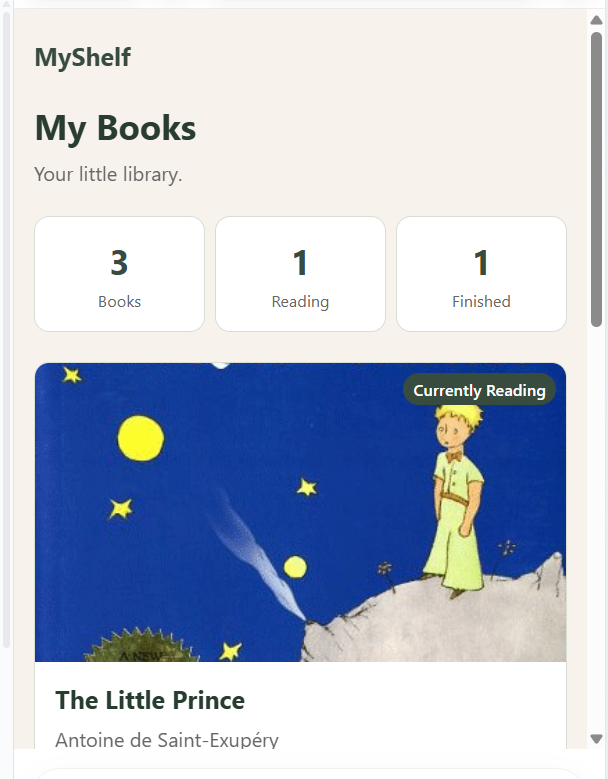

# MyShelf

MyShelf is a personal book library built with React Native, Expo SDK 58 and TypeScript.

Users can view books, reading statuses and book details. The current version uses mock data.

## Run

```sh
npm install
npm start
```

Open the QR code in a compatible Expo Go version.

To open the app in a browser, press `w` in the Expo terminal.

If PowerShell blocks npm, use:

```sh
npm.cmd start
```

## Week 5 — Theme and Layout

- Shared light and dark colours in `src/constants/theme.ts`.
- Automatic theme selection through `src/hooks/use-theme.ts`.
- Shared spacing, font sizes and corner radii.
- Theme colours applied to screens, cards, navigation and status bar icons.
- Reusable book cards with 16:9 images and reading-status badges.
- Summary boxes calculated from book data.
- Responsive layout:
  - One column below 600.
  - Two columns from 600.
  - Three columns from 900.
- Book details centred with a maximum width of 600.
- Safe area support and scrollable content.

The Add Book control is a static preview. Adding, editing and saving books will be implemented in later milestones.

## Project Structure

- `src/app/index.tsx` — book cards and summary statistics.
- `src/app/explore.tsx` — details of the first sample book.
- `src/components/BookCard.tsx` — reusable book card.
- `src/components/shelf-screen.tsx` — shared screen container.
- `src/constants/theme.ts` — colours and design scales.
- `src/hooks/use-theme.ts` — selects light or dark colours.
- `src/data/books.ts` — sample book data.
- `docs/` — screenshots.

## Screenshots

### Light mode



### Dark mode


## Manual Checks

- Switch between light and dark mode while the app is running.
- Increase the phone's text size and check wrapping and scrolling.
- Resize the browser to check one, two and three columns.
- Check that book details stay centred on wide screens.
- Scroll to the bottom and check that the last item is fully visible.

The app keeps portrait orientation on the phone. Different widths are tested in the browser.

## Code Explanation

`StyleSheet.create` defines layout and text styles.

`useTheme` selects colours according to the device's colour scheme.

`useWindowDimensions` determines the number of columns.

`useSyncExternalStore` keeps the initial server and browser column layout consistent before adapting to the browser width.

`reduce` calculates summary statistics from the sample books.

`SafeAreaView` and safe area insets keep content clear of system bars.

`ScrollView` keeps content accessible on smaller screens and with larger text.

Book cover images are loaded from Open Library and require an internet connection.